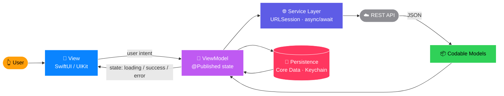

<div align="center">


<br>

<a href="https://github.com/Ceyhun1999">
  
</a>
<a href="https://www.linkedin.com/in/ceyhun-rzayev/">
  
</a>
<a href="mailto:ceyhun.rzayeev@gmail.com">
  
</a>
<a href="https://t.me/jr_solutions">
  
</a>

</div>


<div align="center">

### 📱 &nbsp;Now on the App Store of Developers


</div>


## 🍎 &nbsp;`Developer.swift`

```swift
struct Developer: Identifiable, Hashable {
    let name        = "Ceyhun Rzayev"
    let role        = "iOS Developer"
    let location    = "Azerbaijan 🇦🇿"
    let previously  = "Frontend Developer — production web apps"

    let stack: [String] = [
        "Swift", "SwiftUI", "UIKit",
        "MVVM", "async/await", "REST APIs"
    ]

    var currentMission: String {
        "Ship apps that feel native, not assembled."
    }

    func availability() -> Status {
        .open(for: [.iOSRoles, .collaborations, .interestingProjects])
    }
}
```

I build **modern, maintainable, user-focused iOS applications** — with real attention to architecture, UI precision, and performance.

My **frontend background** isn't a footnote, it's the edge: years of responsive UI work, production deployments, and design-to-pixel discipline. That's why my SwiftUI layouts don't fall apart on an iPhone SE.


## ⚙️ &nbsp;Tech Stack

<div align="center">


<br>


</div>

<table>
<tr>
<td width="25%" valign="top">

### 🧩 Core iOS


</td>
<td width="25%" valign="top">

### 🌐 Networking


</td>
<td width="25%" valign="top">

### 💾 Persistence


</td>
<td width="25%" valign="top">

### 🏗 Architecture


</td>
</tr>
</table>


## 🔄 &nbsp;How My Apps Are Wired



> No massive view controllers. No business logic in the UI layer. Every screen testable on its own.


## 📲 &nbsp;Settings — *tap to expand*

<details>
<summary><b>&nbsp;📱 &nbsp;General → What I Build</b></summary>

<br>

| 📱 Development | 🏗 Engineering |
| :-- | :-- |
| Native iOS applications | MVVM & Clean Architecture |
| SwiftUI + UIKit interfaces | Reusable component systems |
| Navigation & app flow | Performance & memory awareness |
| REST API integration | Dependency injection |
| Local data persistence | Testable, extendable code |

</details>

<details>
<summary><b>&nbsp;🌐 &nbsp;Previously → Frontend Development</b></summary>

<br>

Before iOS, I worked **professionally** as a Frontend Developer — real production apps, real users, real deadlines.

<p>
  
  
  
  
  
</p>

Responsive design · website development · deployment · performance optimization · technical support

**Why it matters for iOS:** UI intuition, layout discipline, API-driven thinking, and shipping to production — none of that expires when the platform changes.

</details>

<details>
<summary><b>&nbsp;💡 &nbsp;Principles → How I Write Code</b></summary>

<br>

- **Clean code isn't decoration.** The next developer might be me in six months, tired.
- **Architecture before features.** Bolting MVVM on afterwards costs three times more.
- **Pixel-perfect is a requirement, not a bonus.** Users don't say "misaligned" — they say "cheap".
- **Every state is a real state.** Loading, empty, error, offline. Not just the happy path.
- **Reuse over repeat.** If I write it twice, it becomes a component.

</details>

<details>
<summary><b>&nbsp;🛠 &nbsp;Tools → Daily Setup</b></summary>

<br>

<p>
  
  
  
  
  
  
  
</p>

</details>


## 🆕 &nbsp;Release Notes

```diff
@@ v3.0 — Current @@
+ Native iOS development with Swift, SwiftUI and UIKit
+ MVVM + Clean Architecture across projects
+ async/await networking layer, full error & loading states
+ Reusable SwiftUI component library
! In progress: deeper iOS architecture, modularization, App Store releases

@@ v2.0 — Frontend Era @@
+ Production web apps: React, JavaScript, Tailwind
+ Responsive UI, deployment, performance optimization

@@ v1.0 — The Beginning @@
+ First line of code. Still shipping.
```


## 📊 &nbsp;GitHub Stats

<div align="center">


<br>


<br>


</div>


<div align="center">

## 🤝 &nbsp;Let's Build Something

**Open to iOS development roles, collaborations, and projects worth shipping.**

<a href="https://www.linkedin.com/in/ceyhun-rzayev/">
  
</a>
<a href="mailto:ceyhun.rzayeev@gmail.com">
  
</a>
<a href="https://t.me/jr_solutions">
  
</a>
<a href="https://github.com/Ceyhun1999">
  
</a>

<br><br>

### 🍎 &nbsp;Code · Build · Ship · Improve


</div>
